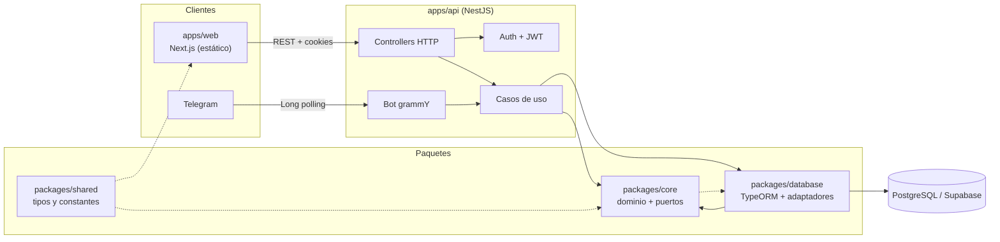

# Documentación del Gestor de Finanzas

Documentación técnica del monorepo `expense-tracker`: backend NestJS con arquitectura hexagonal, bot de Telegram, frontend Next.js y persistencia PostgreSQL/TypeORM.

## Índice

| Documento | Descripción |
|---|---|
| [Arquitectura](./architecture.md) | Monorepo, arquitectura hexagonal, flujo de dependencias y decisiones de diseño |
| [Backend](./backend.md) | NestJS, módulos, casos de uso, autenticación, bot de Telegram y scripts |
| [API HTTP](./api.md) | Referencia de endpoints, cuerpos, respuestas, códigos de estado y errores |
| [Frontend](./frontend.md) | Next.js, rutas, componentes, estado, cliente HTTP y build estático |
| [Base de datos](./database.md) | Esquema, entidades, mappers, migraciones y comandos TypeORM |
| [Despliegue](./deployment.md) | Docker, Render, Cloudflare Pages, variables y topología |
| [Desarrollo](./development.md) | Setup local, scripts, testing, CI y convenciones |

## Recursos de base de datos

- [Esquema SQL de referencia](./database/schema.sql)
- [Fuente DBML para dbdiagram.io](./database/finance.dbml)
- [Diagrama ER (PNG)](./database/er-diagram.png)
- [Fuente Mermaid del ER](./database/er-diagram.mmd)

## Vista general



## Empezar rápido

```bash
pnpm install
pnpm db:migrate
pnpm dev
```

Detalle completo en [Desarrollo](./development.md).
