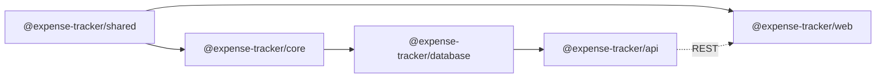
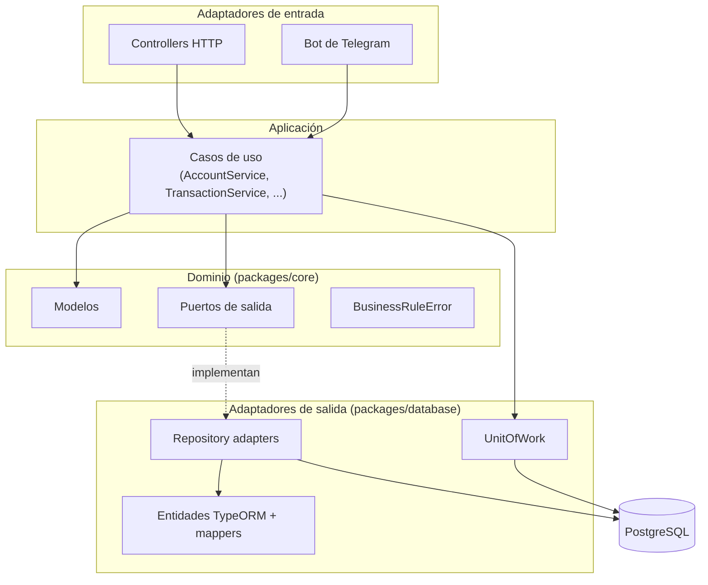
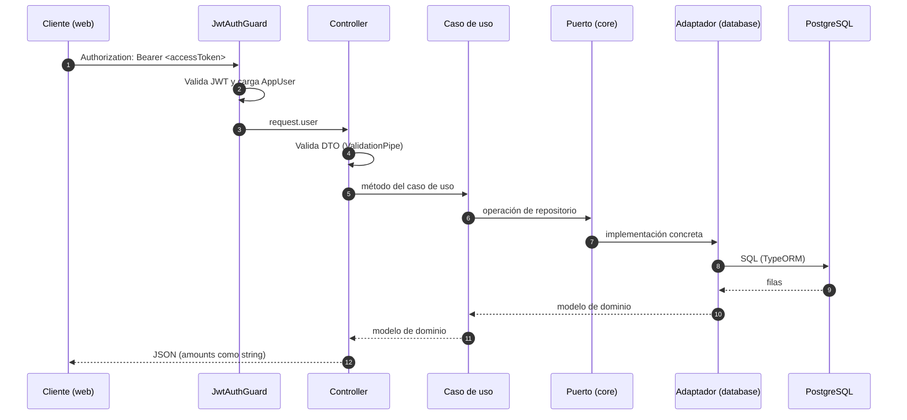
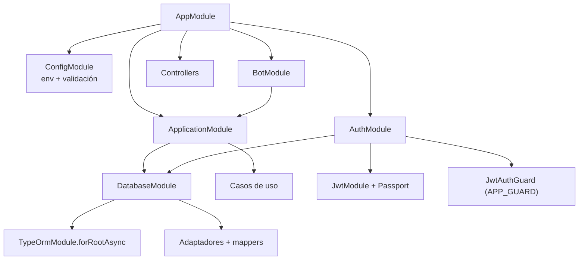

# Arquitectura

Monorepo gestionado con **pnpm workspaces + Turborepo** que implementa una arquitectura **hexagonal (ports & adapters)** con el dominio aislado de la infraestructura.

## Paquetes

| Paquete | Responsabilidad |
|---|---|
| `packages/shared` | Constantes y tipos compartidos entre backend y frontend (`TRANSACTION_TYPES`, `LOAN_STATUSES`, `ApiError`). Sin dependencias. |
| `packages/core` | Dominio: modelos (`Account`, `AppUser`, `Transaction`, `Loan`), puertos de salida y errores de negocio. Solo depende de `decimal.js`. |
| `packages/database` | Infraestructura de persistencia: entidades TypeORM, mappers, adaptadores de los puertos, migraciones y `DataSource`. |
| `apps/api` | Backend NestJS: casos de uso (servicios de aplicación) y adaptadores de entrada (HTTP y Telegram). |
| `apps/web` | Frontend Next.js que consume `shared` y la API REST. |

## Grafo de dependencias



Regla clave: **las dependencias apuntan hacia el dominio**. `core` no conoce TypeORM, Nest ni Postgres. `database` implementa los puertos de `core`. `api` orquesta casos de uso sin acceder directamente a la base de datos.

## Capas hexagonales



### Puertos de salida (`packages/core/src/port/out`)

| Puerto | Token | Operaciones principales |
|---|---|---|
| `AccountRepositoryPort` | `ACCOUNT_REPOSITORY` | `save`, `findById`, `findByUserId`, `delete` |
| `AppUserRepositoryPort` | `APP_USER_REPOSITORY` | `save`, `findAll`, `findById`, `findByEmail`, `findByTelegramChatId` |
| `TransactionRepositoryPort` | `TRANSACTION_REPOSITORY` | `save`, `findById`, `findByUserId` (paginado), `existsByAccountId`, `sumByUserIdAndTypes` |
| `LoanRepositoryPort` | `LOAN_REPOSITORY` | `save`, `findById`, `findByUserId`, `findByUserIdAndStatusIn`, `existsByAccountId` |
| `UnitOfWorkPort` | `UNIT_OF_WORK` | `run<T>(work)` — ejecuta un bloque dentro de una transacción |
| `DatabaseHealthPort` | `DATABASE_HEALTH` | `ping()` |

## Flujo de una petición HTTP



## Composición de módulos NestJS



## Decisiones de diseño

### Dinero con `decimal.js`

Todos los montos usan `Decimal` en el dominio y se transforman a `numeric` en PostgreSQL mediante `decimalTransformer`. La API expone los montos como **string** para evitar pérdida de precisión en JSON.

### Unit of Work con `AsyncLocalStorage`

`TypeOrmUnitOfWork` abre una transacción con `DataSource.transaction` y guarda el `EntityManager` en un `AsyncLocalStorage`. Los adaptadores obtienen el manager mediante `TypeOrmContext.manager`, por lo que cualquier operación dentro de `unitOfWork.run(...)` participa de la misma transacción sin pasar el manager por parámetro.

Esto permite que operaciones compuestas (por ejemplo, descontar saldo + crear transacción + crear préstamo) sean atómicas.

### Mappers explícitos

Los mappers (`AccountMapper`, `AppUserMapper`, `TransactionMapper`, `LoanMapper`) convierten entre entidades TypeORM y modelos de dominio. También validan invariantes que la base de datos permite pero el dominio no (por ejemplo, una cuenta sin usuario o una transacción sin tipo).

### Errores de negocio

- `BusinessRuleError` (dominio) se traduce a **400 Bad Request** mediante `BusinessRuleExceptionFilter`.
- Errores de infraestructura/aplicación usan las excepciones de Nest (`NotFoundException`, `ConflictException`, `UnauthorizedException`, etc.).

### Validación en el borde

Los DTOs usan `class-validator` y el `ValidationPipe` global con `whitelist: true` y `transform: true`. Los montos se validan con la expresión `^\d+(\.\d{1,2})?$`.

## Equivalencias con Java / Spring Boot

| Java / Spring Boot | TypeScript / NestJS |
|---|---|
| `@Service` / `@Component` | `@Injectable()` + módulos Nest |
| `JpaRepository` | `Repository<T>` de TypeORM |
| Entidades JPA + mappers | Entidades TypeORM + mappers |
| `@Transactional` | Puerto `UnitOfWork` + `AsyncLocalStorage` |
| `BigDecimal` | `decimal.js` |
| `TelegramLongPollingBot` | `grammY` |
| `@RestController` | `@Controller` |
| `@Valid` | `ValidationPipe` + `class-validator` |

## Estructura del código

```
packages/core/src/
  model/            # Modelos de dominio
  port/out/         # Puertos de salida
  errors/           # BusinessRuleError
packages/database/src/
  entities/         # Entidades TypeORM
  mappers/          # Dominio <-> persistencia
  adapters/         # Implementaciones de puertos
  migrations/       # Migraciones
  unit-of-work.adapter.ts
  typeorm-context.ts
apps/api/src/
  application/usecase/  # Casos de uso
  infrastructure/       # Auth, seguridad
  interfaces/           # Controllers, DTOs, bot, filtros
  config/               # Configuración y validación de entorno
apps/web/src/
  app/              # Rutas (App Router)
  components/       # UI y componentes de dominio
  lib/              # Cliente API, auth, queries, tipos
```
