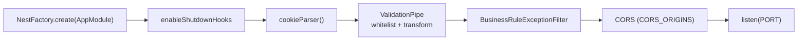
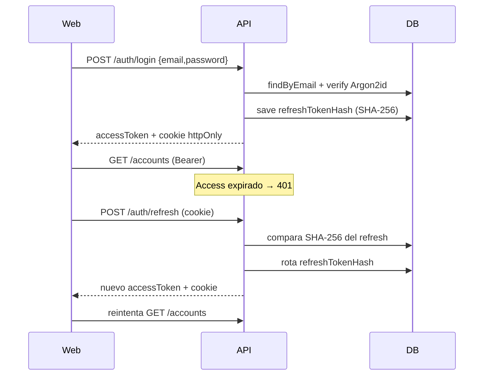

# Backend

Backend en **NestJS 11** con arquitectura hexagonal. Incluye la API REST, la autenticación y el bot de Telegram.

## Arranque (`apps/api/src/main.ts`)



- **Prefijo:** no se usa; las rutas cuelgan de la raíz (`/auth`, `/accounts`, etc.).
- **Validación:** `ValidationPipe({ whitelist: true, transform: true })` elimina propiedades no declaradas y transforma tipos.
- **CORS:** orígenes separados por coma en `CORS_ORIGINS`; `credentials: true` para la cookie de refresco.
- **Filtro global:** `BusinessRuleExceptionFilter` convierte `BusinessRuleError` en `400`.

## Configuración y variables

`apps/api/src/config/configuration.ts` normaliza el entorno:

| Clave | Variable | Default |
|---|---|---|
| `botToken` | `BOT_TOKEN` | `''` |
| `botUsername` | `TELEGRAM_BOT_USERNAME` | `kratos_finanzas_bot` |
| `botEnabled` | `BOT_ENABLED` | `true` (activo salvo `false`) |
| `port` | `PORT` | `8080` |
| `jwtAccessSecret` | `JWT_ACCESS_SECRET` | — (obligatorio) |
| `jwtAccessExpiresIn` | `JWT_ACCESS_EXPIRES_IN` | `15m` |
| `jwtRefreshSecret` | `JWT_REFRESH_SECRET` | — (obligatorio) |
| `jwtRefreshExpiresIn` | `JWT_REFRESH_EXPIRES_IN` | `7d` |
| `cookieSecure` | `COOKIE_SECURE` | `false` (solo `true` activa) |
| `corsOrigins` | `CORS_ORIGINS` | `http://localhost:3000` |

`env.validation.ts` falla al arrancar si faltan `JWT_ACCESS_SECRET`, `JWT_REFRESH_SECRET` o `BOT_TOKEN` (este último solo si el bot está habilitado).

## Módulos

| Módulo | Contenido |
|---|---|
| `AppModule` | `ConfigModule`, `ApplicationModule`, `AuthModule`, `BotModule` y todos los controllers |
| `ApplicationModule` | Casos de uso: `AppUserService`, `AccountService`, `TransactionService`, `LoanService`, `DashboardService`, `HealthService` |
| `AuthModule` | `AuthService`, `PasswordHasher`, `JwtStrategy`, `JwtAuthGuard` global, `AuthController` |
| `DatabaseModule` (paquete) | `TypeOrmModule`, adaptadores, mappers y tokens de puertos |
| `BotModule` | Bot grammY, handlers y `BotUpdate` |

## Casos de uso

### `AccountService`

| Método | Reglas |
|---|---|
| `createAccount(user, name, currency?)` | Nombre obligatorio (trim), moneda a mayúsculas, saldo inicial `0`, default `PEN`. |
| `getAccountsByUser` | Solo cuentas del usuario. |
| `getAccountForUser` | `404` si no existe o pertenece a otro usuario. |
| `updateAccount` | Actualiza nombre y/o moneda. |
| `deleteAccount` | `409` si tiene transacciones o préstamos asociados. |
| `getTotalBalance` | Suma de saldos de todas sus cuentas. |

### `TransactionService`

| Método | Reglas |
|---|---|
| `registerExpense` | Valida saldo suficiente (`BusinessRuleError`); descuenta saldo y crea `EGRESO` en una transacción. |
| `registerIncome` | Incrementa saldo y crea `INGRESO`. |
| `transfer` | Valida saldo en origen y cuentas distintas; crea `TRANSFERENCIA_SALIDA` + `TRANSFERENCIA_ENTRADA` y ajusta ambos saldos atómicamente. |
| `listTransactions` | Filtros `accountId`, `type`, `from`, `to`, paginación; valida `from <= to`. |
| `getTransactionForUser` | Verifica que la transacción pertenezca a una cuenta del usuario. |

### `LoanService`

| Método | Reglas |
|---|---|
| `grantLoan` | Valida saldo y motivo no vacío; descuenta de la cuenta, crea `EGRESO_PRESTAMO` y el préstamo (`PENDIENTE`) persistiendo `description`. |
| `payLoan` | Rechaza préstamo pagado o abono mayor a la deuda; suma a la cuenta, crea `INGRESO_COBRO` y actualiza `paidAmount`/`status`. |
| `getPendingLoans` | Préstamos `PENDIENTE` y `PAGO_PARCIAL`. |
| `listLoans` | Filtro opcional por estado. |
| `grantLoanForUser` / `payLoanForUser` | Validan monto positivo y ownership de cuenta/préstamo. `location = 'Web'`. |

Estados: `PENDIENTE` → `PAGO_PARCIAL` → `PAGADO` (cuando `paidAmount >= amount`).

### `DashboardService`

`getSummary(user, month?)` calcula para el mes indicado (`YYYY-MM`, por defecto mes UTC actual):

- Rango `[primer día del mes, primer día del mes siguiente)`.
- Saldo total de cuentas, ingresos (`INGRESO`), egresos (`EGRESO`) y neto.
- Últimas 5 transacciones.
- Préstamos pendientes y su deuda restante total.

### `HealthService`

Ejecuta `SELECT 1` vía `DatabaseHealthPort` y devuelve `status: 'ok' | 'degraded'`, `uptime`, `timestamp` y `database: 'up' | 'down'`. Si la base falla, el controller responde **503**.

## Autenticación

### Contraseñas

`PasswordHasher` usa **Argon2id** con:

| Parámetro | Valor |
|---|---|
| `algorithm` | Argon2id |
| `memoryCost` | 19456 KiB |
| `timeCost` | 2 |
| `parallelism` | 1 |
| `outputLen` | 32 |
| versión | 0x13 |
| sal mínima | 16 |

`needsRehash()` detecta hashes con política antigua y los actualiza tras un login correcto.

### Tokens

- **Access token:** JWT firmado con `JWT_ACCESS_SECRET`, payload `{ sub, email, jti }`, expiración corta.
- **Refresh token:** JWT firmado con `JWT_REFRESH_SECRET`, payload `{ sub, email, type: 'refresh', jti }`.
- El refresh se envía en cookie **`httpOnly`** (`refresh_token`, `path=/auth`, `sameSite=lax` o `none` si `COOKIE_SECURE`, `maxAge` 7 días) y también se acepta en el body.
- En base de datos solo se guarda el **SHA-256** del refresh vigente (`refresh_token_hash`). Cada refresh **rota** el token.
- `logout` borra el hash y limpia la cookie.



### Endpoints de auth

| Método | Ruta | Auth | Descripción |
|---|---|---|---|
| `POST` | `/auth/register` | Público | Crea usuario web + cuenta `Efectivo`, devuelve tokens. |
| `POST` | `/auth/login` | Público | Valida credenciales y devuelve tokens. |
| `POST` | `/auth/refresh` | Público | Rota refresh token (cookie o body). |
| `POST` | `/auth/logout` | Bearer | Revoca refresh token y limpia cookie (`204`). |
| `GET` | `/auth/me` | Bearer | Perfil público del usuario. |
| `PATCH` | `/auth/credentials` | Bearer | Cambia email y/o contraseña; exige contraseña actual. |

Reglas: email normalizado a minúsculas, contraseña de al menos 8 caracteres, email único (`409`). Al cambiar solo la contraseña se reemiten tokens.

### Guard y decoradores

- `JwtAuthGuard` es global (`APP_GUARD`). Usa Passport + `passport-jwt` (`Bearer`).
- `@Public()` marca controladores/métodos exentos (login, register, refresh, health, `/`).
- `@CurrentUser()` inyecta el `AppUser` cargado por `JwtStrategy`.
- `JwtStrategy.validate` busca al usuario en base de datos; si no existe responde `401`.

## Bot de Telegram (grammY)

El bot usa **long polling** y se activa según `BOT_ENABLED`. Si está deshabilitado, el módulo se registra pero no arranca.

### Comandos

| Comando | Acción |
|---|---|
| `/start` | Registra al usuario por `telegram_chat_id` y crea cuenta `Efectivo` si no tiene. |
| `/comandos` | Lista de ayuda. |
| `/saldo` | Saldo total de cuentas. |
| `/cuentas` | Lista cuentas con saldo. |
| `/nuevacuenta` | Crea una cuenta. |
| `/gasto` | Flujo conversacional de gasto. |
| `/ingreso` | Flujo conversacional de ingreso. |
| `/transferir` | Transferencia entre cuentas (requiere ≥ 2). |
| `/prestar` | Registrar préstamo. |
| `/cobrar` | Registrar abono de un préstamo pendiente. |
| `/prestamos` | Lista de préstamos por cobrar. |
| `/cancelar` | Cancela el flujo y limpia la sesión. |

### Máquina de estados

Cada conversación guarda un `BotState` en sesión (`BotSessionData`) con los datos parciales. `BotUpdate.routeState` despacha el mensaje al handler correspondiente. Ejemplos: `ESPERANDO_CUENTA_GASTO` → `ESPERANDO_MONTO_GASTO` → `ESPERANDO_DESC_GASTO`.

Los montos se parsean con `decimal.js` y se formatean a 2 decimales. Las cuentas se eligen escribiendo su nombre; `BotAccountHelper` resuelve y valida.

## Script `auth:set-credentials`

`apps/api/src/scripts/set-credentials.ts` vincula email/contraseña a un usuario existente (por ejemplo, creado desde Telegram) **sin crear otro usuario**:

1. Carga el contexto de la aplicación con `BOT_ENABLED=false`.
2. Lista usuarios; si hay uno solo lo selecciona automáticamente.
3. Pide email y contraseña (entrada oculta, mínimo 8 caracteres, doble confirmación).
4. Llama a `AuthService.setInitialCredentials`, que normaliza el email, verifica unicidad y guarda el hash.

Conserva `telegram_chat_id`, cuentas, transacciones y préstamos.

```bash
pnpm auth:set-credentials
```

## Errores y validación

| Situación | Respuesta |
|---|---|
| DTO inválido | `400` con `message` (string o array) del `ValidationPipe` |
| Regla de negocio (`BusinessRuleError`) | `400` `{ statusCode, message, error: 'Bad Request' }` |
| Recurso inexistente / ajeno | `404` |
| Conflicto (email, cuenta con movimientos) | `409` |
| Token ausente/inválido | `401` |
| Base de datos caída en `/health` | `503` |

Los DTOs limitan longitudes (`255`), exigen UUIDs para IDs, validan formato `YYYY-MM` para meses y `^\d+(\.\d{1,2})?$` para montos.

## Health y keep-alive

- `GET /health` (público): estado de la base, uptime y timestamp.
- `GET /` (público): texto plano de keep-alive legado.

Para evitar el spin-down de Render free, se recomienda un cron externo (cron-job.org) cada 5–10 minutos apuntando a `/health`. El frontend también hace ping cada 10 minutos.
