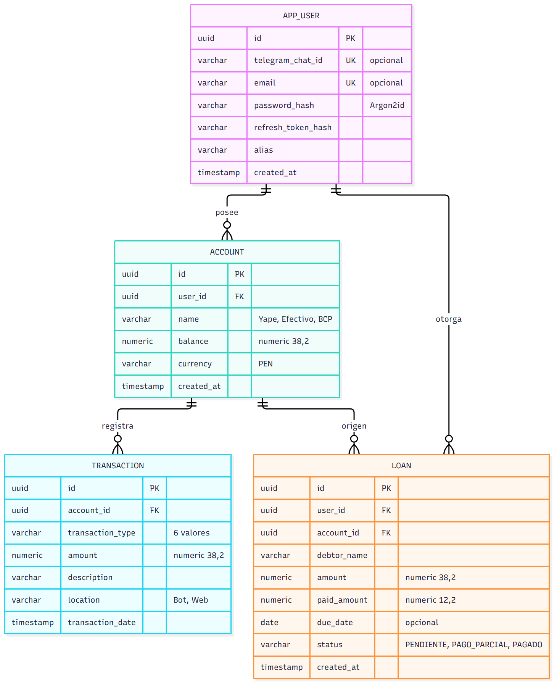
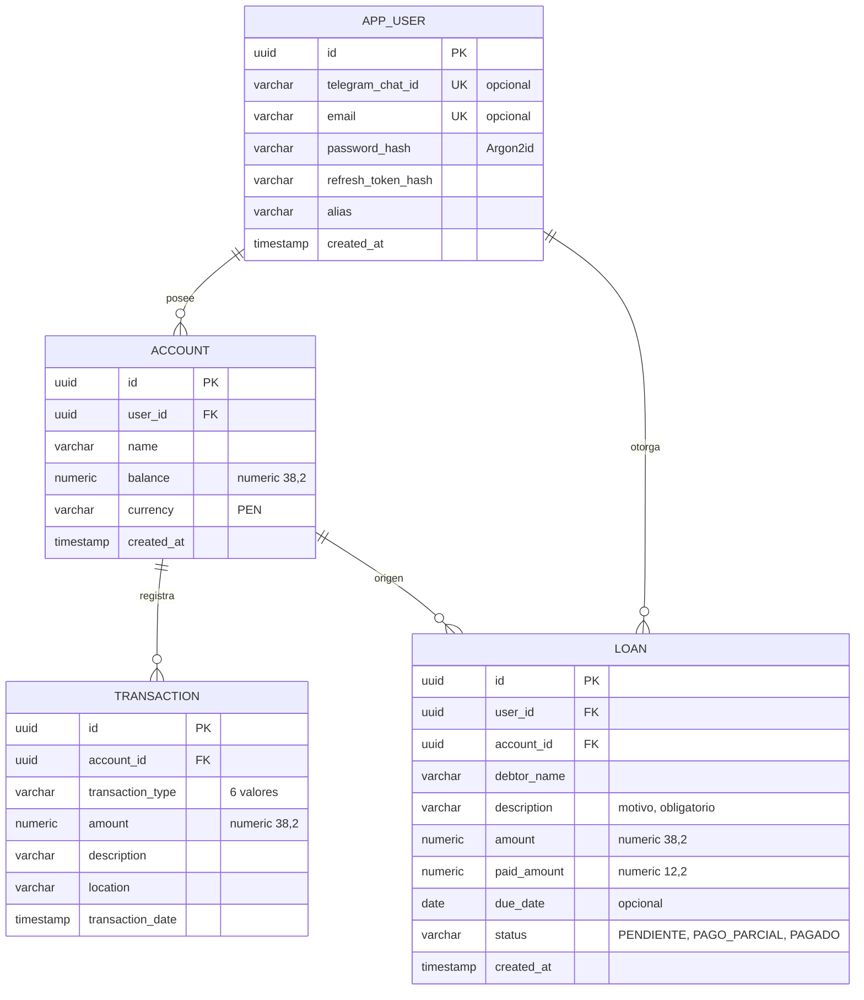
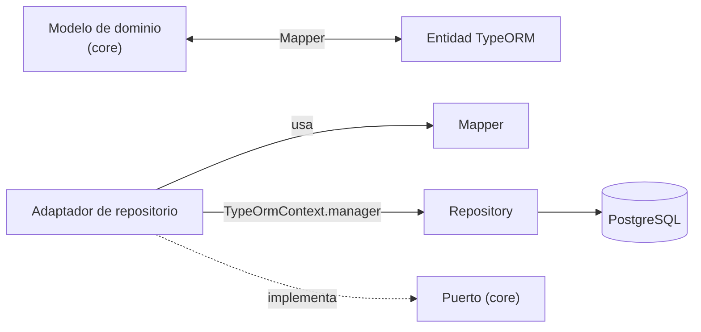
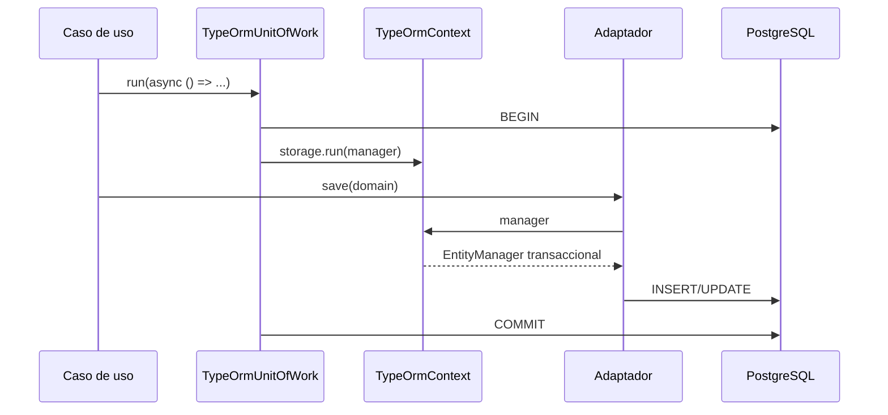

# Base de datos

Persistencia con **PostgreSQL** (local o Supabase) y **TypeORM**, siguiendo el patrón de puertos y adaptadores.

## Recursos

- [Esquema SQL de referencia](./database/schema.sql)
- [Fuente DBML para dbdiagram.io](./database/finance.dbml)
- [Diagrama ER (PNG)](./database/er-diagram.png)
- [Fuente Mermaid del ER](./database/er-diagram.mmd)

> Las migraciones de TypeORM en `packages/database/src/migrations` son la **fuente de verdad**. `schema.sql` es una instantánea del estado final para referencia y para regenerar el diagrama.

## Diagrama entidad-relación





## Tablas

### `app_user`

| Columna | Tipo | Restricciones | Notas |
|---|---|---|---|
| `id` | `uuid` | PK, default `gen_random_uuid()` | |
| `telegram_chat_id` | `varchar(255)` | UNIQUE, NULL | Usuarios del bot |
| `email` | `varchar(255)` | UNIQUE, NULL | Usuarios web |
| `password_hash` | `varchar(255)` | NULL | Argon2id |
| `refresh_token_hash` | `varchar(64)` | NULL | SHA-256 del refresh vigente |
| `alias` | `varchar(255)` | NULL | Nombre visible |
| `created_at` | `timestamp` | NULL | |

Invariante de dominio: al menos `email` o `telegram_chat_id` debe existir (validado por `AppUserMapper`).

### `account`

| Columna | Tipo | Restricciones |
|---|---|---|
| `id` | `uuid` | PK |
| `user_id` | `uuid` | NOT NULL, FK → `app_user.id` (`fkjajia7qudllc01cly9yddon8u`) |
| `name` | `varchar(255)` | NULL |
| `balance` | `numeric(38,2)` | NOT NULL |
| `currency` | `varchar(3)` | NULL (default de dominio `PEN`) |
| `created_at` | `timestamp` | NULL |

### `transaction`

| Columna | Tipo | Restricciones |
|---|---|---|
| `id` | `uuid` | PK |
| `account_id` | `uuid` | NOT NULL, FK → `account.id` (`fk6g20fcr3bhr6bihgy24rq1r1b`) |
| `transaction_type` | `varchar(255)` | NULL |
| `amount` | `numeric(38,2)` | NOT NULL |
| `description` | `varchar(255)` | NULL |
| `location` | `varchar(255)` | NULL (`Bot`, `Web`, ...) |
| `transaction_date` | `timestamp` | NULL |

`transaction_type` admite: `INGRESO`, `EGRESO`, `TRANSFERENCIA_SALIDA`, `TRANSFERENCIA_ENTRADA`, `EGRESO_PRESTAMO`, `INGRESO_COBRO`.

### `loan`

| Columna | Tipo | Restricciones |
|---|---|---|
| `id` | `uuid` | PK |
| `user_id` | `uuid` | NOT NULL, FK → `app_user.id` (`fkjcauugddigslh9xi7v2n9tiwj`) |
| `account_id` | `uuid` | NOT NULL, FK → `account.id` (`fkgv9cgsh4k76wmaf83ktoekpub`) |
| `debtor_name` | `varchar(255)` | NULL |
| `description` | `varchar(255)` | NULL (históricos; obligatorio hacia adelante) |
| `amount` | `numeric(38,2)` | NOT NULL |
| `paid_amount` | `numeric(12,2)` | NOT NULL |
| `due_date` | `date` | NULL |
| `status` | `varchar(255)` | NULL (default de dominio `PENDIENTE`) |
| `created_at` | `timestamp` | NULL (`loanDate`) |

`status` admite: `PENDIENTE`, `PAGO_PARCIAL`, `PAGADO`.

## Entidades, mappers y adaptadores



| Entidad | Mapper | Adaptador |
|---|---|---|
| `AppUserEntity` | `AppUserMapper` | `AppUserRepositoryAdapter` |
| `AccountEntity` | `AccountMapper` | `AccountRepositoryAdapter` |
| `TransactionEntity` | `TransactionMapper` | `TransactionRepositoryAdapter` |
| `LoanEntity` | `LoanMapper` | `LoanRepositoryAdapter` |

Los mappers aplican defaults y validan invariantes: cuentas/préstamos con usuario, transacciones con cuenta y tipo, usuario con email o Telegram. Los adaptadores usan relaciones (`user`, `account`) y consultas con `innerJoin` para filtrar por usuario.

## Montos y precisión

`decimalTransformer` convierte `Decimal` ↔ `numeric`:

- `to`: `new Decimal(value).toString()`.
- `from`: `new Decimal(value)`.

El dominio nunca usa `number` para dinero. La API serializa los montos como `string`.

## Unit of Work

`TypeOrmUnitOfWork` ejecuta un bloque en `DataSource.transaction` y publica el `EntityManager` en un `AsyncLocalStorage`.



Esto hace atómicas las operaciones de gasto/ingreso/transferencia/préstamo (saldo + transacción + préstamo).

## Configuración y conexión

`packages/database/src/env.ts`:

- Carga `packages/database/.env` con `dotenv` (independiente del `.env` de la API).
- `getDatabaseUrl()` exige `DATABASE_URL`.
- `isDatabaseLoggingEnabled()` lee `DB_LOGGING === 'true'`.
- `normalizeDatabaseUrl()` elimina `sslmode` cuando el host es local (`localhost`, `127.0.0.1`, `::1`) para permitir conexiones locales sin SSL.

`data-source.ts` (CLI de TypeORM) y `database.module.ts` (runtime Nest) comparten:

```ts
{
  type: 'postgres',
  url: getDatabaseUrl(),
  entities: typeOrmEntities,
  synchronize: false,
  uuidExtension: 'pgcrypto',
  logging: isDatabaseLoggingEnabled(),
}
```

`synchronize: false`: el esquema solo cambia mediante migraciones.

## Migraciones

| Migración | Contenido |
|---|---|
| `1780000000000-InitialSchema` | Crea tablas si no existen (`IF NOT EXISTS`) y agrega `paid_amount`/`due_date` si faltan. Idempotente. |
| `1780000001000-ConvertIdsToUuid` | Convierte PK/FK de `bigint` a `uuid` preservando datos (requiere `pgcrypto`). **Su `down()` no revierte**: restaurar desde backup. |
| `1780000002000-AddAuthFields` | Hace `telegram_chat_id` nullable y agrega `email`, `password_hash`, `refresh_token_hash` + unique de email. |
| `1780000003000-AddLoanDescription` | Agrega `loan.description` (motivo obligatorio) + backfill desde `transaction` (`EGRESO_PRESTAMO` con formato `Préstamo a X: motivo`). |

> ⚠️ Haz un **backup** antes de ejecutar `ConvertIdsToUuid` en una base con datos.

Las migraciones se validaron contra PostgreSQL 17 en una base limpia; el CI repite esa validación.

## Comandos

```bash
pnpm --filter @expense-tracker/database migration:generate src/migrations/Nombre
pnpm --filter @expense-tracker/database migration:run
pnpm --filter @expense-tracker/database migration:revert
pnpm --filter @expense-tracker/database migration:show
pnpm --filter @expense-tracker/database schema:log
```

Equivalentes desde la raíz: `pnpm db:generate`, `pnpm db:migrate`, `pnpm db:revert`, `pnpm db:show`.

En Docker, el contenedor ejecuta `migration:run` con `dist/data-source.js` antes de arrancar la API.

## Regenerar el diagrama

1. Edita `docs/database/finance.dbml`.
2. Pégalo en [dbdiagram.io](https://dbdiagram.io) y exporta la imagen, o ejecuta:

```bash
npx -y @mermaid-js/mermaid-cli \
  -i docs/database/er-diagram.mmd \
  -o docs/database/er-diagram.png \
  -b white --size 1800
```
