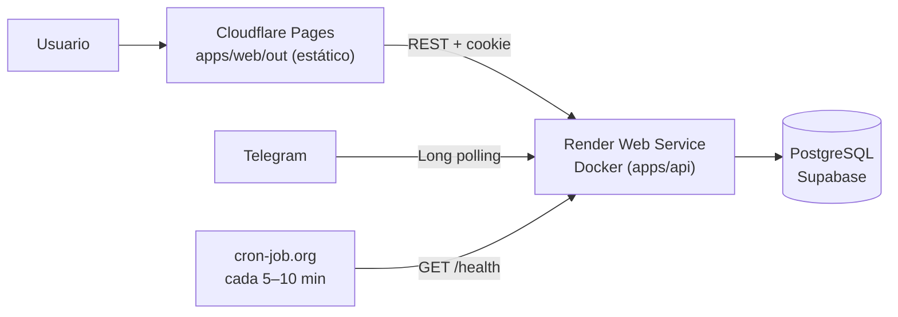
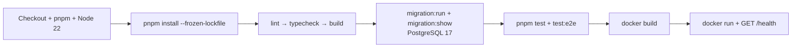

# Despliegue

Topología prevista: frontend estático en **Cloudflare Pages**, API Docker en **Render** y base de datos en **Supabase/PostgreSQL**.



## Docker

El `Dockerfile` vive en la raíz porque necesita el contexto completo del monorepo.

- **Etapa `build`:** instala pnpm 12.14.0, copia los `package.json`, instala con `--frozen-lockfile`, copia el código y compila `shared → core → database → api`.
- **Etapa `runtime`:** solo dependencias de producción + artefactos `dist/`. Expone `8080`.
- **Arranque:** aplica migraciones pendientes y luego inicia la API:

```sh
cd /app/packages/database \
  && node ./node_modules/typeorm/cli.js migration:run -d dist/data-source.js \
  && cd /app/apps/api \
  && node dist/main.js
```

Uso local:

```bash
docker build -t expense-tracker .
docker run --env-file apps/api/.env --env-file packages/database/.env -p 8080:8080 expense-tracker
```

## Render (backend)

`render.yaml` define un Web Service Docker opcional (plan free, health check `/health`). Pasos manuales si el servicio ya existe:

1. Conecta el repositorio como **Web Service** (runtime Docker).
2. Contexto: raíz del repositorio; Dockerfile: `./Dockerfile`.
3. Configura las variables de entorno (ver matriz).
4. Health check path: `/health`.
5. Configura un cron externo cada 5–10 minutos apuntando a `https://tu-api.onrender.com/health` para evitar el spin-down del plan free.
6. El despliegue se ejecuta automáticamente desde la rama configurada.

Variables declaradas en `render.yaml`:

| Variable | Origen |
|---|---|
| `DATABASE_URL` | Manual |
| `BOT_TOKEN` | Manual |
| `BOT_ENABLED` | `true` |
| `TELEGRAM_BOT_USERNAME` | `kratos_finanzas_bot` |
| `JWT_ACCESS_SECRET` | Generado |
| `JWT_ACCESS_EXPIRES_IN` | `15m` |
| `JWT_REFRESH_SECRET` | Generado |
| `JWT_REFRESH_EXPIRES_IN` | `7d` |
| `COOKIE_SECURE` | `true` |
| `CORS_ORIGINS` | Manual (dominio del frontend) |
| `PORT` | `8080` |

## Cloudflare Pages (frontend)

El frontend se publica como export estático; no requiere SSR ni Workers.

1. Crea un proyecto en **Cloudflare Pages** conectado al repositorio.
2. **Root directory:** raíz del repositorio.
3. **Install command:** `pnpm install --frozen-lockfile`.
4. **Build command:** `pnpm turbo run build --filter=@expense-tracker/web`.
5. **Build output directory:** `apps/web/out`.
6. Variables de build:
   - `NEXT_PUBLIC_API_URL=https://tu-api.onrender.com`
   - `NODE_VERSION=22`
   - `PNPM_VERSION=12.14.0` si Cloudflare no detecta pnpm.
7. En Render, agrega `https://<proyecto>.pages.dev` y tu dominio personalizado a `CORS_ORIGINS`.
8. Mantén `COOKIE_SECURE=true` para cookies cross-site (`SameSite=None`).

Cada ruta se genera como HTML estático; los datos y la sesión se resuelven en el navegador contra la API.

## Matriz de variables de entorno

| Variable | `apps/api` | `packages/database` | `apps/web` | Producción |
|---|:---:|:---:|:---:|---|
| `BOT_TOKEN` | ✅ | | | Secreto |
| `TELEGRAM_BOT_USERNAME` | ✅ | | | Opcional |
| `BOT_ENABLED` | ✅ | | | `true` / `false` |
| `PORT` | ✅ | | | `8080` |
| `JWT_ACCESS_SECRET` | ✅ | | | Secreto largo |
| `JWT_ACCESS_EXPIRES_IN` | ✅ | | | `15m` |
| `JWT_REFRESH_SECRET` | ✅ | | | Secreto largo |
| `JWT_REFRESH_EXPIRES_IN` | ✅ | | | `7d` |
| `COOKIE_SECURE` | ✅ | | | `true` |
| `CORS_ORIGINS` | ✅ | | | Dominio(s) del frontend |
| `DATABASE_URL` | | ✅ | | URL PostgreSQL (no JDBC) |
| `DB_LOGGING` | | ✅ | | `false` |
| `NEXT_PUBLIC_API_URL` | | | ✅ | URL pública de la API |

> `DATABASE_URL` debe ser una URL estándar (`postgresql://...`). Si el host es local, `sslmode` se ignora automáticamente. `packages/database` carga su propio `.env`, por lo que la API no duplica esas variables.

## CI (`.github/workflows/ci.yml`)

Se ejecuta en push a `master`, `feat/**`, `refactor/**`, `chore/**`, `fix/**`, `docs/**` y en pull requests.



- Job `quality`: PostgreSQL 17 como servicio, migraciones reales, tests unitarios y e2e.
- Job `docker`: construye la imagen, la arranca con PostgreSQL y espera hasta 60 intentos a que `/health` responda.

Esto valida lo que `pg-mem` no cubre: migraciones reales y arranque del contenedor.

## Checklist antes de mergear a `master`

1. CI en verde (incluye migraciones reales y Docker).
2. Backup de la base de producción.
3. Ejecutar migraciones en staging/copia antes de producción.
4. Configurar en Render: `DATABASE_URL`, `BOT_TOKEN`, `JWT_ACCESS_SECRET`, `JWT_REFRESH_SECRET`, `COOKIE_SECURE=true`, `CORS_ORIGINS`, `BOT_ENABLED`.
5. Cron externo apuntando a `/health` cada 5–10 minutos.
6. Mergear y verificar `/health` del servicio desplegado.
7. Desplegar el frontend en Cloudflare Pages y probar login, dashboard, cuentas, transacciones y préstamos.

## Rollback y migraciones

- Antes de desplegar un cambio de esquema, crea un backup.
- `ConvertIdsToUuid` **no** se revierte automáticamente; si falla, restaura el backup.
- El contenedor aplica migraciones al arrancar: un fallo en la migración impide el arranque de la API (fail-fast).
- Para verificar diferencias entre entidades y base: `pnpm --filter @expense-tracker/database schema:log`.
