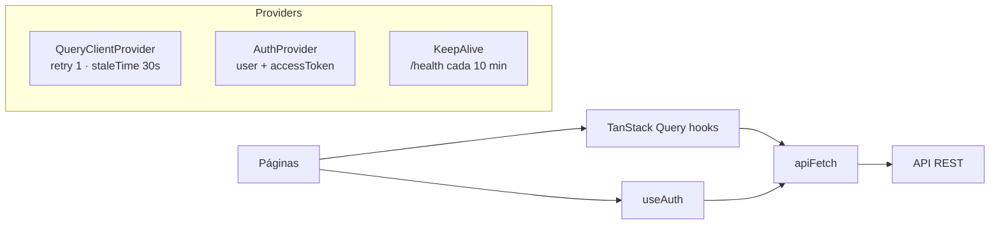

# Frontend

Aplicación **Next.js 16** (App Router) + **React 19** + **Tailwind CSS 4**. Se compila como **export estático** y consume la API REST desde el navegador.

## Stack

| Herramienta | Uso |
|---|---|
| Next.js 16 (`app/`) | Enrutado por archivos y layout |
| React 19 | UI |
| Tailwind CSS 4 (`@tailwindcss/turbopack`) | Estilos |
| TanStack Query | Fetching, caché e invalidación |
| React Hook Form + Zod | Formularios y validación |
| `lucide-react` | Iconografía |
| `@expense-tracker/shared` | Enums/tipos compartidos |

## Build estático

`apps/web/next.config.ts`:

```ts
const nextConfig: NextConfig = {
  output: 'export',
  turbopack: {
    rules: {
      '*.css': { loaders: ['@tailwindcss/turbopack'], as: '*.css' },
    },
  },
};
```

- `next build` genera HTML estático en `apps/web/out/`.
- No hay SSR ni route handlers: toda la sesión y los datos se resuelven en el cliente contra la API.
- Necesita `NEXT_PUBLIC_API_URL` en tiempo de build.

## Rutas (App Router)

```
src/app/
  layout.tsx                 # <html> + Providers
  page.tsx                   # Redirige a /dashboard o /login según sesión
  globals.css
  (auth)/
    layout.tsx               # Fondo centrado
    login/page.tsx
    register/page.tsx
  (dashboard)/
    layout.tsx               # DashboardGuard + DashboardShell
    dashboard/page.tsx
    accounts/page.tsx
    transactions/page.tsx
    loans/page.tsx
    settings/page.tsx
```

| Ruta | Descripción |
|---|---|
| `/` | Redirección según sesión (`FullPageSpinner` mientras carga). |
| `/login` | Inicio de sesión con email/contraseña. |
| `/register` | Registro de usuario web (crea cuenta `Efectivo`). |
| `/dashboard` | Resumen del mes: saldo, ingresos, egresos, neto, préstamos y últimas transacciones. |
| `/accounts` | CRUD de cuentas con modales de creación/edición y confirmación de borrado. |
| `/transactions` | Historial con filtros `cuenta`, `tipo`, `desde`, `hasta`, paginación y alta de gasto/ingreso/transferencia. |
| `/loans` | Listado por estado, creación de préstamos y registro de abonos. |
| `/settings` | Perfil y cambio de email/contraseña. |

## Componentes

```
src/components/
  accounts/account-form.tsx
  auth/auth-card.tsx, login-form.tsx, register-form.tsx
  dashboard/dashboard-view.tsx
  layout/dashboard-guard.tsx, dashboard-shell.tsx
  loans/loan-form.tsx, loan-payment-form.tsx
  settings/credentials-forms.tsx
  transactions/movement-form.tsx, transfer-form.tsx
  ui/button.tsx, input.tsx, select.tsx, modal.tsx, spinner.tsx
```

- `DashboardGuard`: espera a que `AuthProvider` restaure la sesión; si no hay usuario redirige a `/login`.
- `DashboardShell`: sidebar en desktop y navegación horizontal en móvil, con cierre de sesión.
- Componentes `ui/*` reutilizables y sin lógica de negocio.

## Estado y datos



### Consultas (`src/lib/queries`)

| Hook | Endpoint / queryKey |
|---|---|
| `useAccounts` | `GET /accounts` — `['accounts']` |
| `useCreateAccount`, `useUpdateAccount`, `useDeleteAccount` | `POST/PATCH/DELETE /accounts` |
| `useTransactions` | `GET /transactions` — `['transactions', filters]` |
| `useCreateExpense`, `useCreateIncome`, `useCreateTransfer` | `POST /transactions/*` |
| `useLoans` | `GET /loans[?status]` — `['loans', status]` |
| `useCreateLoan`, `useRegisterLoanPayment` | `POST /loans`, `POST /loans/:id/payments` |
| `useDashboardSummary` | `GET /dashboard/summary[?month]` — `['dashboard-summary', month]` |

Las mutaciones invalidan `accounts`, `transactions`, `loans` y `dashboard-summary` según corresponda para refrescar la UI.

Configuración de `QueryClient`: `retry: 1`, `staleTime: 30_000`, `refetchOnWindowFocus: false`.

## Autenticación en el cliente

- El **access token** vive en memoria (`api-client.ts`), no en `localStorage`.
- Al montar, `AuthProvider` llama a `POST /auth/refresh` (cookie `httpOnly`) para restaurar la sesión.
- `login`, `register` y `updateCredentials` guardan el token y el usuario.
- `apiFetch`:
  - Añade `Authorization: Bearer` si hay token.
  - Usa `credentials: 'include'` para la cookie de refresh.
  - Ante `401` (excepto en `/auth/*`), renueva la sesión una vez y reintenta la petición.
  - Deduplica refresh concurrentes con `refreshPromise`.
  - Lanza `ApiError` con `status`, `message` y `body`; `getErrorMessage` extrae mensajes de validación (string o array).
- `logout` llama a la API, limpia el token y el usuario.

## Keep-alive

`Providers` incluye `KeepAlive`, que llama a `GET /health` al montar, cada 10 minutos y cuando la pestaña vuelve a ser visible. Complementa el cron externo configurado en Render.

## Utilidades

`src/lib/format.ts`:

- `formatCurrency` (Intl `es-PE`, PEN por defecto).
- `formatDate`, `formatDateOnly`, `formatMonth`.
- `transactionLabel` y `loanStatusLabel` para los enums.
- `cn` combina clases condicionales.

## Formularios

Todos usan `react-hook-form` + `zod` con `zodResolver`:

- Montos: `^\d+(\.\d{1,2})?$` y > 0.
- Descripciones/nombres obligatorios, `máx. 255`.
- Transferencias: cuentas origen y destino distintas.
- Abonos: no pueden superar la deuda pendiente (validación en cliente + servidor).
- Los errores del servidor se muestran en un aviso `serverError`.

## Variables de entorno

| Variable | Descripción |
|---|---|
| `NEXT_PUBLIC_API_URL` | URL base de la API (default `http://localhost:8080`). Se usa en build. |

## Scripts

```bash
pnpm --filter @expense-tracker/web dev        # Next.js dev
pnpm --filter @expense-tracker/web build      # export estático en out/
pnpm dlx serve apps/web/out                   # previsualizar el export
pnpm --filter @expense-tracker/web lint
pnpm --filter @expense-tracker/web typecheck
```

## Notas de Next.js 16

La app usa APIs y convenciones de Next.js 16, que pueden diferir de versiones anteriores. Antes de modificar código del frontend, revisa la documentación local en `node_modules/next/dist/docs/` (ver `apps/web/AGENTS.md`).
